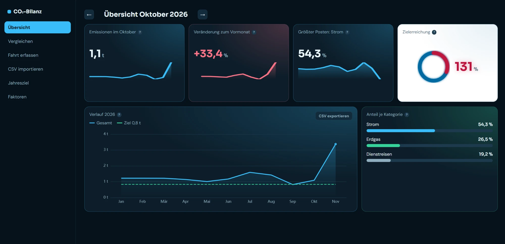
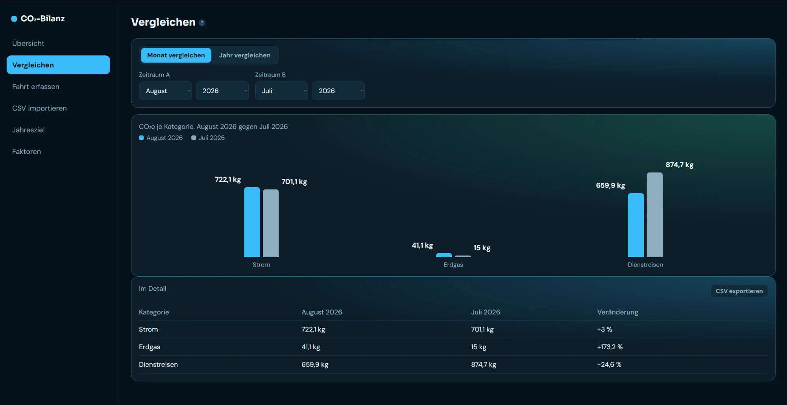

# Nachhaltigkeits-KPI-Dashboard

DVA-Seminar, THA Augsburg, Thema 24 — Einzelprojekt Lukas Maurer (WI, Herbst 2026).

Ein Prototyp, der CO₂e-Emissionen einer fiktiven Firma (Strom, Erdgas, Dienstreisen)
als interaktives Dashboard darstellt. Datenbasis sind CSV-Importe; die Emissionsfaktoren
stammen aus der UBA-Liste zur Treibhausgasbilanzierung, Version 2.1 (02/2026, Bezugsjahr 2024).

---



---

**Vergleichen-Seite** (Monat- oder Jahresvergleich, kombinierbar nach Kategorie):



## Angezeigte KPIs

| KPI | Beschreibung |
|-----|--------------|
| CO₂e im Monat | Summe aller Messungen des gewählten Monats in kg oder t |
| Anteil je Kategorie | Prozentualer Anteil von Strom, Erdgas und Dienstreisen |
| Veränderung zum Vormonat | Relative Änderung zur Vorperiode, kombinierbar nach Kategorie |
| Zielerreichung | Ist-Verbrauch im Verhältnis zum Monatsbudget (Jahresziel ÷ 12); über 100 % = Budget überschritten |

Datenquelle für Emissionsfaktoren: Umweltbundesamt (UBA), Liste „Emissionsfaktoren zur
Treibhausgasbilanzierung", V 2.1, 28.02.2026. Belege liegen unter `data/`.

## Voraussetzungen

- Python 3.12 oder neuer
- Node.js 18 oder neuer

## Installation und Start

**Einmalig einrichten:**

```bash
python -m venv .venv
.venv\Scripts\activate
pip install -r requirements.txt
cd frontend
npm install
cd ..
```

**Starten (Windows):**

```
start.bat
```

Öffnet zwei Terminalfenster: Backend auf <http://localhost:8000>, Frontend auf <http://localhost:5173>.

**Oder einzeln starten:**

```bash
# Terminal 1 – Backend
.venv\Scripts\activate
uvicorn backend.api:app --reload
```

```bash
# Terminal 2 – Frontend
cd frontend
npm run dev
```

Beim ersten Start wird `dashboard.db` automatisch angelegt und mit den Emissionsfaktoren
befüllt (siehe `backend/seed/faktoren.py`).

## Testdaten einspielen (optional)

Das Dashboard startet leer. Kleiner Testdatensatz (3 Monate):

```
data/testdaten_minimal.csv
```

Über die Import-Seite im Frontend (Drag & Drop oder Datei wählen) hochladen,
oder über die API-Doku unter <http://localhost:8000/docs>.

**Fiktive Demo-Firma (24 Monate, Dez 2024 – Nov 2026):**

```bash
python -m backend.seed.beispieldaten
# erzeugt data/beispieldaten_24_monate.csv und data/beispieldaten_fehler.csv
```

**Datenbank zurücksetzen** (Messwerte löschen, Faktoren und Ziel bleiben):

```bash
python reset_measurements.py
```

## Tests

```bash
pytest
```

## Technik

| Schicht | Bibliotheken |
|---------|-------------|
| Backend | FastAPI, Pydantic, Uvicorn |
| Datenhaltung | SQLite (via `sqlite3`-Standardbibliothek) |
| CSV-Import | Polars |
| Tests | pytest, httpx |
| Frontend | React 19, Vite, TypeScript |
| Diagramme | Apache ECharts (`echarts-for-react`) |

## Projektstruktur

```
backend/
  core/         units.py, kpis.py – reine Python-Logik, keine Fremd-Importe
  db.py         SQLite-Schema und -Abfragen
  importer.py   CSV-Import mit Polars, Teil-Import, Fachprüfungen
  api.py        FastAPI-Endpunkte
  seed/         Emissionsfaktoren-Stammdaten und Beispieldatengenerator
frontend/
  src/
    tokens.ts       Design-Tokens (Farben) – einzige Quelle für CSS und ECharts
    components/     Dashboard-Komponenten (KpiKarte, VerlaufDiagramm, …)
    explain/        texte.json – Erklär-Texte für die Hover-Tooltips
tests/            pytest, ein Modul je Backend-Modul
data/             Testdaten und UBA-Belegdateien
```

## Entstehung

Das Projekt entstand im Rahmen des DVA-Seminars (Herbst 2026) als eigenständige
Seminararbeit. Die Umsetzung erfolgte mit KI-Unterstützung (Claude); mein Schwerpunkt lag auf:

- **Konzept und KPI-Auswahl**: Ich habe die vier Kennzahlen ausgewählt, das Datenmodell
  festgelegt (Messungen, Faktoren, Ziele) und die Datenquelle recherchiert und geprüft
  (UBA-Faktoren, V 2.1, direkter Abgleich mit der Excel-Tabelle).
- **KPI „Veränderung zum Vormonat"**: Diese Funktion habe ich in `backend/core/kpis.py`
  selbst implementiert (inkl. Tests, Edge Cases, Bewusste-0-Behandlung).
- **Design-Entscheidungen**: Ich habe die Farbpalette (Tiefsee + Grün), die Glow-Technik
  und das Bento-Karten-Layout festgelegt; die Design-Tokens in `frontend/src/tokens.ts`
  spiegeln meine Vorgaben wider.
- **Zielerreichungs-Logik umgedreht**: Nach erstem Prototyp habe ich die Richtung der
  Zielerreichungskarte selbst geändert – von „mehr ist besser" zu „Budget-Verbrauch",
  damit Überschreitungen sichtbar werden.
- **Prüfung und Steuerung**: Jedes Modul habe ich im Teach-back erklärt; die
  Commit-Texte enthalten meine eigene Formulierung. Entscheidungen (z. B. Erdgas-Faktor
  Brennwert statt Heizwert) habe ich recherchiert und begründet.

## Lizenz

MIT License — siehe [LICENSE](LICENSE).
